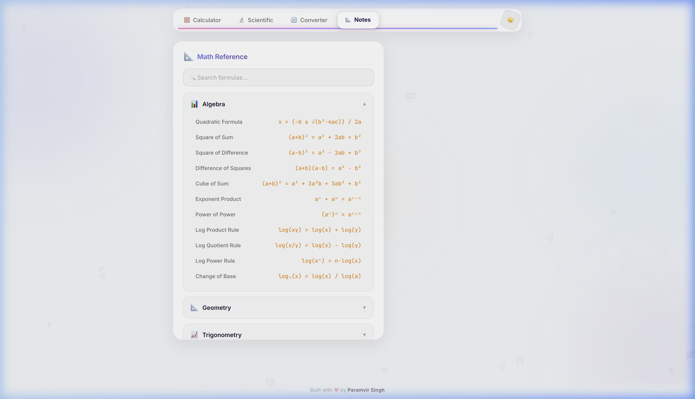

# ⚡ CalcPro — Scientific Calculator & Smart Unit/Currency Converter

<p align="center">
  
</p>

<p align="center">
  <b>A modern, glassmorphic all-in-one calculator with Jitter-style animations, scientific precision, live currency conversion, and unit converter.</b>
</p>

<p align="center">
  <a href="https://paramvirsingh08.github.io/calcpro/"></a>
  
  
  
  
  
</p>

---

## ✨ Features at a Glance

| Feature | Description |
|---|---|
| 🔤 **Jitter "Sliding Text Reveal"** | Masked digit slots where numbers slide in from behind a mask upon keystroke/click, and results cascade in like a wave |
| 🎚️ **Jitter "Animated Slider"** | Glowing gradient slider track with a smooth floating pill thumb using spring physics (`cubic-bezier(0.34, 1.56, 0.64, 1)`) |
| 🧮 **Scientific Calculator** | Full trig functions (`sin`, `cos`, `tan`), logs (`log`, `ln`), powers (`x²`, `x³`, `xʸ`), roots (`√`, `∛`), `n!`, constants ($\pi, e$), and DEG/RAD slider |
| 💱 **Real-Time Currency Converter** | 30+ world currencies (USD, INR, EUR, GBP, JPY, CAD, AUD, etc.) with live Exchange Rate API and instant offline fallback |
| 🔄 **Multi-Category Unit Converter** | 9 categories: Length, Weight, Temperature, Area, Volume, Speed, Time, Data, and Currency |
| 📚 **Interactive Math Notes** | Quick-reference collapsible cards for Algebra, Geometry, Trigonometry, Calculus, and Constants with real-time search |
| 🌙 **Dark & Light Mode** | Fluid theme switcher with persistent preference saved to `localStorage` |
| 📋 **Calculation History** | Visual history tape storing recent calculations with click-to-reuse capability |
| ⌨️ **Full Keyboard Support** | Comprehensive keyboard shortcuts for fast calculation workflow |

---

## 📸 Screenshots Showcase

<table width="100%">
  <tr>
    <td width="50%" align="center">
      <b>Scientific Calculator (DEG / RAD Slider)</b><br/>
      
    </td>
    <td width="50%" align="center">
      <b>Live Currency & Unit Converter</b><br/>
      
    </td>
  </tr>
  <tr>
    <td colspan="2" align="center">
      <b>Clean Light Theme</b><br/>
      
    </td>
  </tr>
</table>

---

## 🚀 Quick Start

No installations, build steps, or external dependencies required! Just vanilla HTML, CSS, and JavaScript.

### 1. Clone the repository
```bash
git clone https://github.com/paramvirsingh08/calcpro.git
cd calcpro
```

### 2. Open in your browser
```bash
# macOS
open index.html

# Linux
xdg-open index.html

# Windows
start index.html
```

Or run via any local server (e.g., VS Code Live Server or `npx serve .`).

---

## 🎹 Keyboard Shortcuts

| Key | Action |
|---|---|
| `0` - `9` | Input digits |
| `+`, `-`, `*`, `/` | Arithmetic operators |
| `.` | Decimal point |
| `Enter` or `=` | Calculate result (triggers cascading reveal) |
| `Backspace` | Delete last character (animated exit) |
| `Escape` or `Delete` | Clear all (AC) |
| `%` | Percentage calculation |

---

## 🛠️ Tech Stack & Architecture

- **Vanilla HTML5:** Semantic elements, accessible ARIA attributes, SEO metadata.
- **Vanilla CSS3:** CSS Custom Properties (Theming), Glassmorphism (`backdrop-filter`), CSS Grid, Spring Curves, and Keyframe animations.
- **Modern JavaScript (ES6+):** Object-oriented state management, dynamic DOM rendering, real-time Currency Exchange API fetching, and `localStorage` persistence.

---

## 👤 Author

**Paramvir Singh**
- GitHub: [@paramvirsingh08](https://github.com/paramvirsingh08)
- Email: paramvirsingh040308@gmail.com

---

## 📄 License

This project is licensed under the MIT License — see the [LICENSE](LICENSE) file for details.
